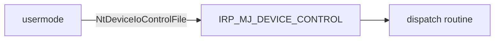

Первые ~200 символов текста попадают в превью карточки на главной, так что
не начинай пост с воды.

## Код

```c
NTSTATUS DriverEntry(_In_ PDRIVER_OBJECT DriverObject,
                     _In_ PUNICODE_STRING RegistryPath)
{
    UNREFERENCED_PARAMETER(RegistryPath);
    DriverObject->DriverUnload = DriverUnload;
    return STATUS_SUCCESS;
}
```
{: file="src/driver.c" }

Инлайн-путь оформляется так: `C:\Windows\System32\ntoskrnl.exe`{: .filepath }

## Плашки

> Полезно знать.
{: .prompt-tip }

> Осторожно, тут ловушка.
{: .prompt-warning }

## Картинка

Файл лежит в `assets/img/posts/hello-world/`, в тексте пишется только имя,
потому что задан `media_subpath`.

<!-- {: width="800" height="400" }
_Подпись под картинкой_ -->

## Mermaid



## Сноски и ссылки

Сноска[^1] и ссылка на [документацию темы](https://chirpy.cotes.page/).

[^1]: Текст сноски.
